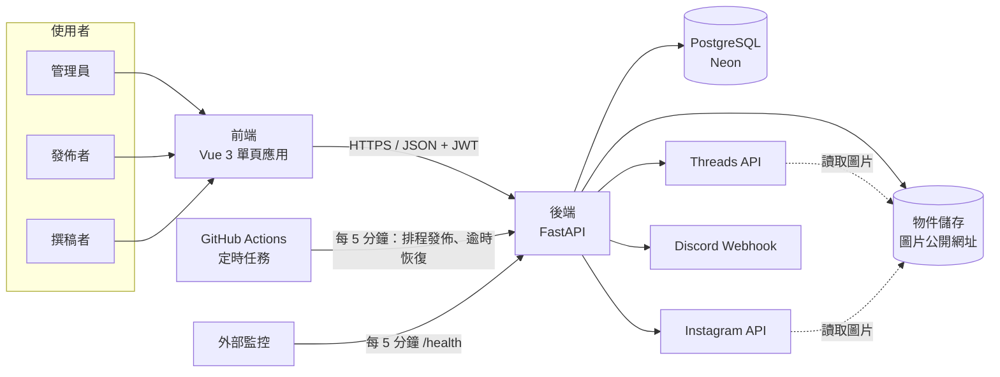
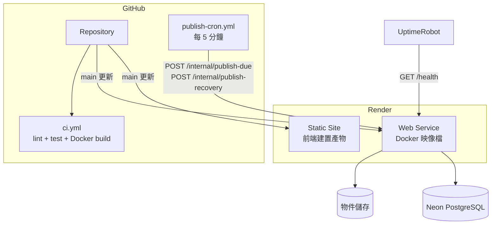
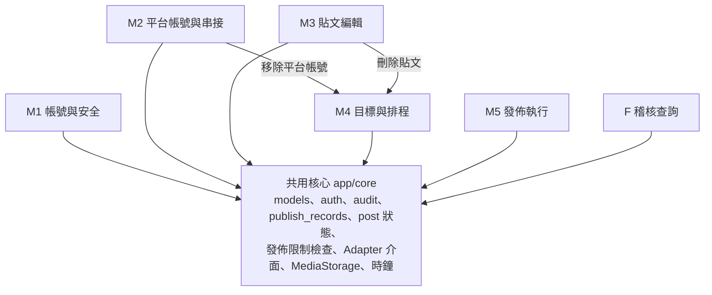
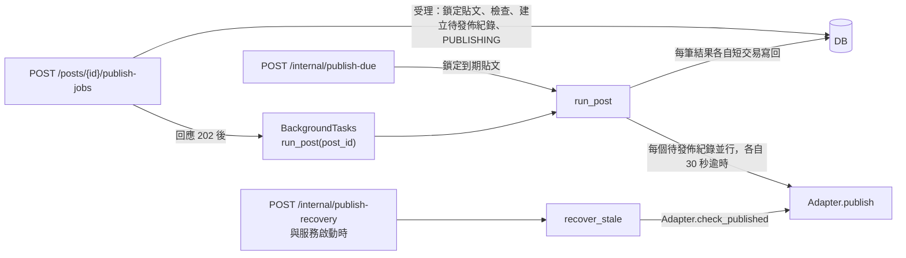
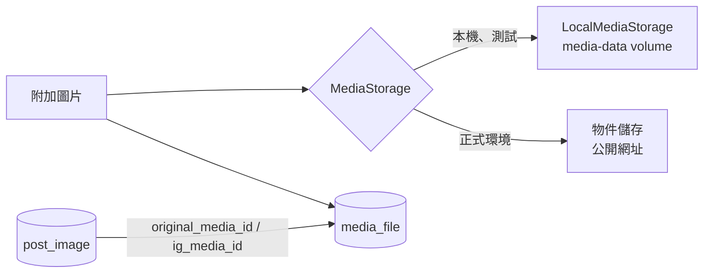
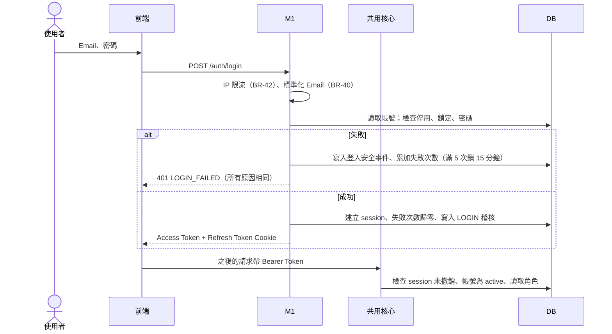
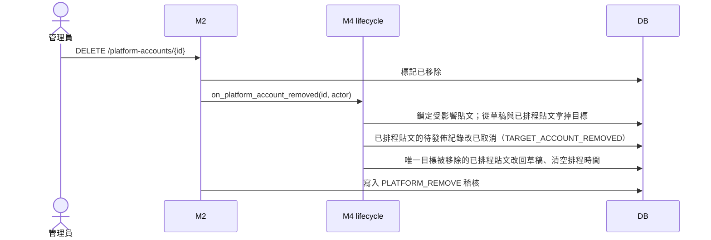
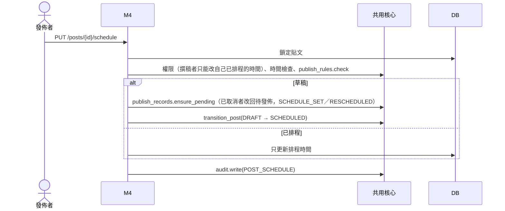
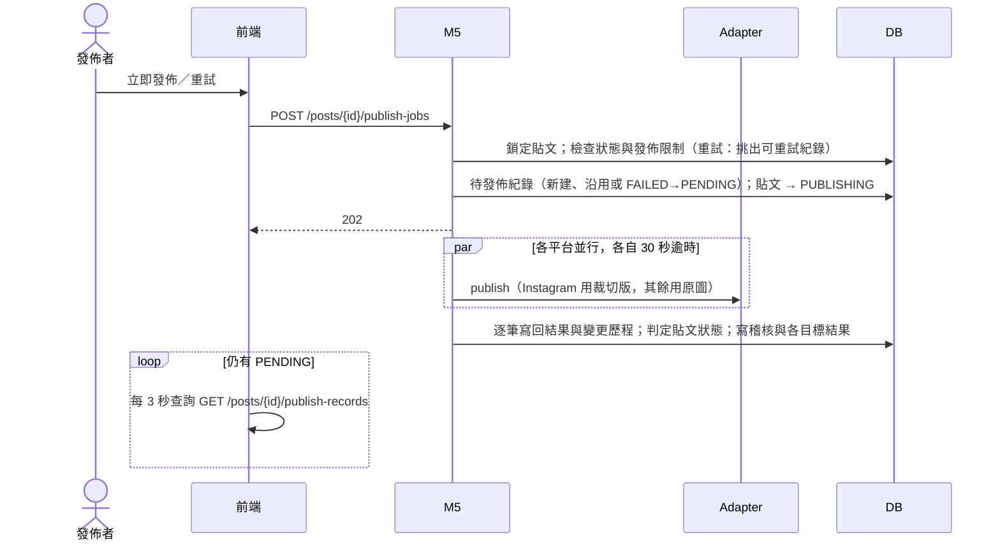
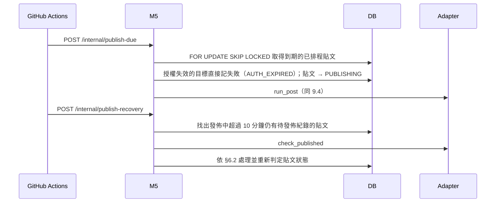

# mediagent 系統架構設計

> 對象：mediagent 全體組員
> 依據：`docs/requirements.md`、`spec/erm.dbml`、`spec/features/`
> 繳交時放在 `docs/architecture.md`
> 相關文件：《mediagent 資料模型》（資料表、欄位、代碼、寫入權限）、《mediagent API 設計》（端點、錯誤碼）、《mediagent 團隊協作規範》（分工、流程、規則）、《mediagent Issue 撰寫規範》
>
> 圖表使用 Mermaid，在 GitHub 或安裝 Mermaid 擴充套件的 VS Code 中可直接顯示。需求編號以 `docs/requirements.md` 為準。

---

## 目錄

1. 架構目標與限制
2. 系統全貌
3. 部署架構與開發環境
4. 模組架構與分工
5. 共用核心
6. 發佈引擎
7. 平台串接（Adapter）
8. 圖片處理與儲存
9. 主要流程
10. 前端架構
11. 安全架構
12. 可觀測性與維運
13. 測試架構（pytest-bdd）
14. 擴充設計
15. 架構決策紀錄
16. 待討論事項
17. 與課程規範的對應

---

## 1. 架構目標與限制

### 1.1 目標

| 目標 | 來源 | 架構上的做法 |
|---|---|---|
| 一個平台失敗不影響其他平台 | BR-14、NFR-03 | 每個平台各自一筆發佈紀錄、各自 30 秒逾時；Adapter 不向外拋出例外 |
| 不重複發文 | BR-16、BR-27 | 「貼文＋平台帳號」唯一；寫回結果前確認仍為待發佈 |
| 已取消或改回草稿的貼文不會被發佈 | NFR-11 | 所有狀態變更先鎖定貼文；排程掃描使用 `SKIP LOCKED` |
| 排程 10 分鐘內開始發佈 | NFR-01 | 外部定時任務每 5 分鐘觸發 |
| 背景任務中斷不遺失 | BR-33 | 逾時恢復：定時任務與服務啟動時檢查 |
| 社團帳號不因系統被入侵而被盜 | NFR-02、NFR-06 | 憑證加密，金鑰與資料庫分開；最小權限授權 |
| 登出與停用立即生效 | BR-43、NFR-07 | JWT + session 表；每次請求檢查 session 與帳號狀態 |
| 可追查 | FR-19、NFR-08 | 只能新增的稽核表與變更歷程（資料庫觸發器保護） |
| 不連真實平台也能測試 | NFR-04 | MockAdapter；本機圖片儲存；可替換的時鐘 |
| **7 人能同時平行開發** | 團隊需求 | 共用核心先行、每張表只有一個寫入者、跨模組呼叫只剩 2 條 |

### 1.2 限制

| 限制 | 對架構的影響 |
|---|---|
| 課程統一技術：Python、FastAPI、PostgreSQL、pytest、GitHub Actions、Docker、Render、Neon | 技術選擇固定 |
| 免費雲端方案 | 後端閒置會休眠，不能常駐排程；Render 磁碟不保存檔案 |
| Threads、Instagram 從公開網址讀取圖片 | 正式環境圖片須放物件儲存 |
| 課程進度：W06 OpenAPI、W07 架構與資料模型、W13 部署 | 共用核心與合約須在 W07 前完成 |
| 使用量小（單一社團） | 單一後端實例；不需要快取、訊息佇列 |

---

## 2. 系統全貌



- 前端只透過 `/api/v1` 與後端溝通，**《API 設計》與 `openapi.yaml` 是前後端合約**。
- 後端是唯一能接觸資料庫與平台憑證的元件。
- 排程不在後端內部常駐執行，而由外部定時任務呼叫內部端點。

---

## 3. 部署架構與開發環境

### 3.1 環境

| 環境 | 用途 | 組成 | 部署來源 |
|---|---|---|---|
| 本機開發 | 開發與測試 | Docker Compose：PostgreSQL + 後端 + 前端；圖片存本機 volume；平台使用 MockAdapter | feature 分支 |
| CI | 自動測試與建置檢查 | GitHub Actions + PostgreSQL service；lint、型別檢查、pytest（含 pytest-bdd）、Docker build；只用 MockAdapter | 每個 PR |
| 正式環境 | Demo 與實際使用 | Render Static Site（前端）+ Render Web Service（以 `Dockerfile` 部署後端）+ Neon + 物件儲存 | `main`，merge 後自動部署 |

### 3.2 部署圖



### 3.3 部署注意事項

- **冷啟動**：Render 免費方案閒置 15 分鐘後休眠，喚醒約 1 分鐘。定時任務逾時設 120 秒並重試一次。
- **Migration**：容器啟動時由 `scripts/entrypoint.sh` 執行 `alembic upgrade head`，本機與正式環境同一套機制。
- **啟動時的逾時恢復**：服務啟動完成後執行一次逾時恢復檢查（BR-33「系統重新啟動時同樣執行恢復檢查」）。
- **圖片不可存在 Render 磁碟**：重新部署後會消失。
- **Swagger UI**：正式環境保留 `/docs`、`/openapi.json`（課程規定）。

### 3.4 Repository 結構

課程規定根目錄須有 `README.md`、`docs/`、`app/`、`tests/`、`Dockerfile`、`requirements.txt`、`.github/workflows/`：

```
mediagent/
├── app/
│   ├── core/              共用核心（§5），D 整合維護
│   │   ├── config.py          設定（Settings）— D
│   │   ├── db.py              資料庫連線與交易工具 — D
│   │   ├── models.py          全部 ORM models — D
│   │   ├── enums.py           代碼列舉（《資料模型》§2）— D
│   │   ├── errors.py          DomainError、全域 handler、錯誤碼常數 — D
│   │   ├── clock.py           可替換時鐘 clock.now() — D
│   │   ├── auth.py            身分驗證與角色依賴 — M1
│   │   ├── audit.py           稽核寫入 audit.write() — M1
│   │   ├── platforms.py       Adapter 介面、MockAdapter、有效授權狀態 — M2
│   │   ├── media.py           MediaStorage 介面與 LocalMediaStorage — M3
│   │   ├── publish_rules.py   發佈限制檢查 publish_rules.check() — M3
│   │   ├── posts.py           貼文狀態轉換 transition_post() — M4
│   │   └── publish_records.py 發佈紀錄與變更歷程 — M4
│   ├── m1_accounts/       M1 帳號與安全
│   ├── m2_platforms/      M2 平台帳號與串接（含真實 Adapter）
│   ├── m3_posts/          M3 貼文編輯
│   ├── m4_scheduling/     M4 目標與排程（含跨模組公開介面 lifecycle.py）
│   ├── m5_publishing/     M5 發佈執行
│   ├── audit_query/       F 稽核查詢
│   └── main.py            組裝 router、啟動時逾時恢復
├── tests/
│   ├── bdd/
│   │   ├── conftest.py    Rule+Example 去重載入器與 @pending 跳過 hook，D 維護
│   │   ├── steps/         共用步驟（§13），D 維護
│   │   └── test_<功能>.py 每個 feature 一個檔，由該 feature 的模組負責
│   ├── unit/              各模組單元測試（目錄對應 app/）
│   └── conftest.py
├── spec/                  erm.dbml、features/*.feature（pytest-bdd 直接讀取）
├── alembic/ alembic.ini
├── seeds/
├── scripts/entrypoint.sh
├── frontend/              Vue 3
│   └── src/
│       ├── shared/        F 維護：版面、router、api client、產生型別、labels.ts
│       └── modules/       m1-accounts/、m2-platforms/、m3-posts/、m4-scheduling/、m5-publishing/、audit-query/
├── docs/                  requirements.md、api-design.md、openapi.yaml、architecture.md、data-model.md …
├── .github/workflows/     ci.yml、publish-cron.yml
├── Dockerfile
├── docker-compose.yml
├── requirements.txt
├── requirements-dev.txt
├── .env.example
└── README.md
```

### 3.5 後端 Docker 映像檔

同一個 `Dockerfile` 用於本機、CI 建置檢查與 Render 部署。

```dockerfile
# 後端映像檔：本機 Docker Compose 與 Render 正式環境共用
FROM python:3.12-slim

ENV PYTHONDONTWRITEBYTECODE=1 \
    PYTHONUNBUFFERED=1 \
    PIP_NO_CACHE_DIR=1

WORKDIR /srv

# 先複製依賴清單，程式碼變動時可沿用快取層
COPY requirements.txt .
RUN pip install -r requirements.txt

COPY app/ app/
COPY alembic/ alembic/
COPY alembic.ini .
COPY seeds/ seeds/
COPY scripts/entrypoint.sh scripts/entrypoint.sh

# 以非 root 使用者執行；本機圖片目錄需屬於該使用者，volume 首次掛載時才可寫入
RUN useradd --create-home --uid 1000 appuser \
    && chmod +x scripts/entrypoint.sh \
    && mkdir -p /srv/media && chown appuser /srv/media
USER appuser

EXPOSE 8000
ENTRYPOINT ["scripts/entrypoint.sh"]
# Render 會提供 PORT；本機預設 8000
CMD ["sh", "-c", "exec uvicorn app.main:app --host 0.0.0.0 --port ${PORT:-8000}"]
```

`scripts/entrypoint.sh`：

```sh
#!/bin/sh
# 容器啟動時先把資料庫升級到最新版本，再啟動服務
set -e
alembic upgrade head
exec "$@"
```

- 先複製 `requirements.txt` 再複製程式碼，只改程式碼時不必重新安裝套件。
- 以非 root 使用者執行；本機圖片目錄 `/srv/media` 預先交給該使用者，volume 掛載後才可寫入。
- `ENTRYPOINT` 先 migration，再以 `exec` 啟動服務，讓 uvicorn 直接接收停止訊號。
- 埠號讀取 `PORT`（Render 提供），本機預設 8000。

### 3.6 Docker Compose（本機開發）

```yaml
# 本機開發環境：docker compose up
name: mediagent

services:
  db:
    image: postgres:17
    environment:
      POSTGRES_USER: mediagent
      POSTGRES_PASSWORD: mediagent
      POSTGRES_DB: mediagent
    ports:
      - "5432:5432"
    volumes:
      - db-data:/var/lib/postgresql/data
    healthcheck:
      test: ["CMD-SHELL", "pg_isready -U mediagent -d mediagent"]
      interval: 5s
      timeout: 3s
      retries: 10

  api:
    build: .
    # 沒有 .env 也能啟動；需要真實平台金鑰時才建立 .env
    env_file:
      - path: .env
        required: false
    environment:
      DATABASE_URL: postgresql+psycopg://mediagent:mediagent@db:5432/mediagent
      DEV_MODE: "1"
      JWT_SECRET: ${JWT_SECRET:-dev-only-jwt-secret}
      CREDENTIAL_ENCRYPTION_KEYS: ${CREDENTIAL_ENCRYPTION_KEYS:-}
      CRON_SECRET: ${CRON_SECRET:-dev-only-cron-secret}
      FRONTEND_ORIGIN: http://localhost:5173
      # 本機圖片存在 media-data volume，由 API 提供網址；正式環境改用物件儲存
      MEDIA_STORAGE_BACKEND: local
    ports:
      - "8000:8000"
    depends_on:
      db:
        condition: service_healthy
    # 開發時掛載原始碼並自動重新載入
    volumes:
      - ./app:/srv/app
      - ./alembic:/srv/alembic
      - ./seeds:/srv/seeds
      - ./tests:/srv/tests
      - media-data:/srv/media
    command: ["uvicorn", "app.main:app", "--host", "0.0.0.0", "--port", "8000", "--reload"]
    healthcheck:
      test: ["CMD", "python", "-c", "import urllib.request; urllib.request.urlopen('http://localhost:8000/health')"]
      interval: 10s
      timeout: 3s
      retries: 5

  frontend:
    image: node:24-alpine
    working_dir: /web
    environment:
      VITE_API_BASE_URL: http://localhost:8000
    ports:
      - "5173:5173"
    volumes:
      - ./frontend:/web
      - frontend-node-modules:/web/node_modules
    command: sh -c "corepack enable && pnpm install && pnpm dev --host 0.0.0.0 --port 5173"
    depends_on:
      api:
        condition: service_healthy

volumes:
  db-data:
  media-data:
  frontend-node-modules:
```

| 服務 | 內容 | 啟動順序 |
|---|---|---|
| `db` | PostgreSQL 17，資料存在 `db-data` volume；`pg_isready` 健康檢查 | 最先 |
| `api` | 本專案 `Dockerfile`；啟動時 migration；掛載原始碼並 `--reload`；圖片存 `media-data` volume；`/health` 健康檢查 | `db` 健康後 |
| `frontend` | Node 24 執行 Vite 開發伺服器；`node_modules` 獨立 volume | `api` 健康後 |

- 沒有 `.env` 也能啟動；本機不需要任何雲端帳號。
- `dev-only-*` 預設密鑰只限本機；正式環境密鑰只設定在 Render。

| 用途 | 指令 |
|---|---|
| 啟動全部 | `docker compose up` |
| 載入測試資料 | `docker compose exec api python -m seeds.seed_dev` |
| 執行全部測試 | `docker compose run --rm api pytest` |
| 只跑某個功能的驗收測試 | `docker compose run --rm api pytest tests/bdd/test_立即發佈.py` |
| 新增 migration | `docker compose exec api alembic revision --autogenerate -m "M3 ..."` |
| 重設本機資料 | `docker compose down -v` |

---

## 4. 模組架構與分工

### 4.1 模組與負責的功能

| 模組 | 負責的功能（`spec/features/`） | 規則數 | 另外負責 |
|---|---|---|---|
| **M1 帳號與安全** | 登入、登出、登出所有裝置、建立幹部帳號、查看幹部帳號、調整角色、停用帳號、啟用帳號、解除鎖定 | 67 | 簽發 JWT、session、IP 限流 |
| **M2 平台帳號與串接** | 連結平台帳號、重新連結平台帳號、查看平台帳號、移除平台帳號 | 55 | OAuth 流程、**Threads、Instagram、Discord 真實 Adapter** |
| **M3 貼文編輯** | 建立貼文草稿、修改貼文、刪除貼文、附加圖片、移除圖片、複製為新草稿、查詢貼文列表、預覽貼文 | 68 | 圖片處理與 Instagram 裁切 |
| **M4 目標與排程** | 設定目標平台帳號、設定排程、取消排程、查看發佈結果 | 63 | 發佈紀錄生命週期服務（`lifecycle`） |
| **M5 發佈執行** | 立即發佈、執行排程發佈、重試發佈、發佈逾時恢復 | 80 | 發佈引擎、定時任務端點 |
| **F 前端骨架與稽核查詢** | 查詢稽核紀錄 | 13 | 前端版面、路由、共用元件、API client、代碼中文對照 |
| **D DevOps 與共用核心** | — | — | 共用核心、共用測試步驟、Docker、CI、部署、定時任務設定 |

M1～M5、F 皆為**垂直切片**：負責自己功能的後端、前端頁面與 pytest-bdd 驗收測試。

### 4.2 依賴關係



- **跨模組呼叫只有兩條**：M2 移除平台帳號時呼叫 `lifecycle.on_platform_account_removed()`；M3 刪除貼文前呼叫 `lifecycle.on_post_deleting()`。兩者都由 M4 提供，M4 不依賴任何功能模組。
- **M4 與 M5 互不依賴**：M4 只建立與取消發佈紀錄，M5 只執行；兩者透過資料庫中的發佈紀錄狀態銜接，並共用核心的 `publish_records` 函式。
- **M5 不依賴 M2**：M5 只透過核心的 Adapter 介面發佈，真實 Adapter 由 M2 實作後註冊。開發與測試時使用 MockAdapter。
- 讀取任何表都可以；寫入只依《資料模型》§4 的寫入權限矩陣。

### 4.3 模組內分層

每個模組統一為 `router → service → repository`，不可反向或跳層；跨模組只能呼叫對方 `lifecycle.py` 公開的函式，不可 import 對方的 `service` 或 `repository`。詳見團隊規範 §5.2。

### 4.4 一個頁面由多個模組組成時

貼文編輯頁同時包含 M3（內容、圖片、預覽）、M4（目標、排程、發佈結果）、M5（立即發佈、重試）的功能。做法：

- F 提供頁面骨架 `PostEditorPage.vue` 與版面區塊。
- 各模組提供自己的元件：M3 `PostContentEditor`、`ImageUploader`、`PreviewPanel`；M4 `TargetSelector`、`SchedulePanel`、`PublishRecordList`；M5 `PublishActions`。
- 元件之間只透過貼文 ID 與 TanStack Query 的快取失效溝通，不直接呼叫彼此。

---

## 5. 共用核心

共用核心在 **Sprint 0（W06～W07）** 完成，之後各模組只依賴已經存在的介面，可以同時開發。每個部分由一位組員主筆、D 負責整合與 review。

| 項目 | 內容 | 主筆 | 使用者 |
|---|---|---|---|
| 設定與資料庫 | `Settings`、資料庫連線、交易工具 | D | 全部 |
| **全部 ORM models 與第一版 migration** | 依《資料模型》一次建立全部表、`CHECK`、索引、`global_event_seq`、只能新增表的觸發器 | D | 全部 |
| 代碼列舉 | 《資料模型》§2 的所有代碼 | D | 全部 |
| 錯誤處理 | `DomainError` 基底類別、全域 handler、《API 設計》§4 的錯誤碼常數 | D | 全部 |
| 時鐘 | `clock.now()`，測試可固定時間（對應 `Given 現在時間為 …`） | D | 全部 |
| 身分驗證依賴 | `get_current_user`（驗證 JWT、session、帳號狀態）、`require_role(min_role)`、`ensure_owner_or_role()`、開發模式 | M1 | 全部 |
| 稽核 | `audit.write(action, actor, target, ..., target_results=None)` | M1 | 全部 |
| 貼文狀態 | `transition_post(post, to_status)`：檢查 BR-12 合法轉換 | M4 | M4、M5 |
| 發佈紀錄 | `publish_records.ensure_pending()`、`cancel()`、`set_result()`、`record_history()`：建立、改狀態並同時寫變更歷程 | M4 | M4、M5 |
| 發佈限制檢查 | `publish_rules.check(post, targets, image, now)`：BR-01、02、05、07、08、09 與圖片寬高 | M3 | M3、M4、M5 |
| 平台介面 | `Capabilities`、`PlatformAdapter`、`get_adapter()`、`MockAdapter`、`effective_auth_status()`、`mark_auth_invalid()` | M2 | M2、M3、M4、M5 |
| 圖片儲存 | `MediaStorage` 介面、`LocalMediaStorage` | M3 | M3、M5 |
| 共用測試步驟 | 39 個跨模組步驟（§13） | D（各模組協助） | 全部 |
| 前端基礎 | 版面、路由與角色守衛、API client、由 OpenAPI 產生型別、代碼中文對照 | F | 全部 |

---

## 6. 發佈引擎

### 6.1 執行模型



- **受理與執行分開**：受理在請求的交易內完成並立即回應（BR-30）；執行在背景進行。
- **`run_post(post_id)`** 是立即發佈、排程發佈、重試、自動重試共用的唯一執行入口：
  1. 讀取該貼文所有 `PENDING` 紀錄。
  2. 以 `asyncio.gather(..., return_exceptions=True)` 並行呼叫各平台 Adapter，各自包覆 `asyncio.wait_for(..., 30)`；若單一 Adapter 意外拋出未預期例外，引擎攔截並轉為失敗原因 `FailureReason.OTHER`（逾時轉為 `TIMEOUT`），確保不中斷其他平台結果寫回（BR-14、NFR-03）。兩階段發佈平台（Instagram、Threads）在建立 container 取得 ID 後、進入輪詢或發佈前，先以短交易寫入 `platform_request_ref`（與 `attempt_started_at`），避免 30 秒逾時取消或服務中斷時遺失 container 參照。
  3. 每筆結果各自短交易寫回：確認仍為 `PENDING` 才寫；寫入發佈內容、圖片識別資訊、變更歷程。
  4. 全部結束後依 BR-15 判定貼文狀態，寫入稽核紀錄與各目標結果。
- **排程發佈前的授權檢查**：授權失效的目標不送出，直接記為失敗、原因 `AUTH_EXPIRED`（BR-31）。

### 6.2 逾時恢復（BR-33）

觸發：定時任務每 5 分鐘（`allow_auto_retry=True`）、服務啟動時（`allow_auto_retry=False`，嚴格遵守 BR-33「系統重新啟動時同樣執行恢復檢查，不直接重新發佈」）。`recover_stale` 掃描對象：`status = 'PUBLISHING'` 且 `publishing_started_at <= now() - 10 分鐘` 的貼文：
- 若該貼文已無 `PENDING` 紀錄（例如背景寫完各筆結果後、更新貼文狀態前程序崩潰的孤兒 `PUBLISHING` 貼文），直接依 BR-15 結算最終 `post.status`（並補齊稽核紀錄）。
- 若仍有 `PENDING` 紀錄，逐筆呼叫 `Adapter.check_published` 確認：

| Adapter 確認結果 | 處理 | 變更原因 |
|---|---|---|
| 已發佈 | 記為成功 | `RECOVERY_CONFIRMED_PUBLISHED` |
| 確認未發佈，定時任務（`allow_auto_retry=True`）且 `auto_retry_count = 0` | 自動重新發佈一次（`auto_retry_count` 加 1），紀錄維持待發佈直到有結果；寫入 `PUBLISH_AUTO_RETRY` 稽核 | `AUTO_RETRY_SUCCEEDED`／`AUTO_RETRY_FAILED` |
| 確認未發佈，已自動重試過**或**為服務啟動檢查（`allow_auto_retry=False`） | 記為失敗、原因 `TIMEOUT`，不直接重新發佈，使用者可手動重試 | `RECOVERY_CONFIRMED_NOT_PUBLISHED` |
| 無法確認 | 記為失敗、原因 `TIMEOUT`，不重發 | `RECOVERY_UNCONFIRMED` |

處理完重新判定貼文狀態。只有狀態實際改變才寫變更歷程。

### 6.3 併發控制

見《資料模型》§6。重點：所有改變貼文狀態或發佈紀錄的操作，先 `SELECT ... FOR UPDATE` 鎖定貼文；排程掃描使用 `FOR UPDATE SKIP LOCKED`；背景寫回前確認紀錄仍是 `PENDING`。

---

## 7. 平台串接（Adapter）

### 7.1 介面（共用核心，M2 主筆）

```python
class Capabilities(BaseModel):
    max_text_length: int              # Threads 500、Instagram 2200、Discord 2000
    requires_image: bool              # Instagram 為 True
    min_aspect_ratio: float | None    # Instagram 0.8
    max_aspect_ratio: float | None    # Instagram 1.91
    auth_expires: bool                # Threads、Instagram 為 True

class PublishResult(BaseModel):
    success: bool
    platform_post_id: str | None = None
    platform_post_url: str | None = None
    request_ref: str | None = None            # 平台中途識別碼，供逾時恢復確認
    failure_reason: FailureReason | None = None   # AUTH_INVALID、PLATFORM_UNAVAILABLE、CONTENT_REJECTED、OTHER
    platform_error_message: str | None = None     # 已過濾憑證

class ConfirmResult(Enum):
    PUBLISHED = "published"
    NOT_PUBLISHED = "not_published"
    UNKNOWN = "unknown"

class PlatformAdapter(Protocol):
    platform: Platform
    capabilities: Capabilities
    def count_chars(self, text: str) -> int: ...                       # 依平台官方定義（4.7）
    async def publish(self, credential: Credential, content: PostContent) -> PublishResult: ...
    async def check_published(self, credential: Credential, record: PublishRecordRef) -> ConfirmResult: ...
```

- **Adapter 不向外拋出例外**，所有錯誤轉成 `PublishResult`；逾時由引擎處理並記為 `TIMEOUT`。
- `count_chars` 讓 BR-02 依平台計算字數；W08 依官方文件與實測補上，目前先以 Unicode 字元數計算。
- 平台明確回應授權無效時回傳 `AUTH_INVALID`，引擎呼叫 `mark_auth_invalid()`（BR-09）。

### 7.2 各平台實作重點（M2）

| 平台 | 連結 | 發佈 | 確認是否已發佈 |
|---|---|---|---|
| Threads | OAuth；取得帳號名稱、識別碼、長效 Token 到期時間 | 建立 container → 發佈；`request_ref` 存 container ID | 以 container 或帳號近期貼文查詢 |
| Instagram | OAuth；帳號須為專業帳號 | 以 Instagram 版本圖片網址建立 container → 發佈 | 同上 |
| Discord | 貼上 Webhook 網址，呼叫 Discord 驗證 | Webhook 加上 `?wait=true` 取得訊息 ID；原圖以附件上傳 | 沒有訊息 ID 時無法確認，回傳 `UNKNOWN` |

### 7.3 MockAdapter（共用核心）

- 開發與測試時，三個平台都註冊為 MockAdapter，但沿用各自真實的 `Capabilities`。
- 可設定每次呼叫的行為：成功、失敗（指定原因）、逾時、授權失效；`check_published` 可設定回傳值。對應 spec 中的 `Given 平台帳號 "X" 的發佈結果為失敗…` 等步驟。
- 記錄收到的貼文，供 `Then 平台帳號 "X" 收到 N 則貼文` 驗證。

---

## 8. 圖片處理與儲存

### 8.1 Instagram 自動裁切（BR-06，M3）

| 原圖寬 ÷ 高 | Instagram 版本 |
|---|---|
| 0.8～1.91（含兩端） | 與原圖相同，不另存 |
| 小於 0.8 | 寬度不變，高度裁成 `round(寬 ÷ 0.8)`，從中間裁 |
| 大於 1.91 | 高度不變，寬度裁成 `round(高 × 1.91)`，從中間裁 |

被裁邊長四捨五入後若比例仍超出範圍，每次減 1 像素直到符合。以 Pillow 處理，比例上下限讀取 Instagram 的 `Capabilities`。

### 8.2 儲存與引用



- 檔案資訊存在 `media_file`；`post_image` 只參照。複製為新草稿時新貼文參照同一組 `media_file`。
- 刪除或移除圖片後，若 `media_file` 已無任何引用，同一交易刪除該列，交易提交後刪除實體檔案（4.3）。

---

## 9. 主要流程

### 9.1 登入與每次請求的驗證（M1、共用核心）



### 9.2 移除平台帳號（M2 → M4）



### 9.3 設定排程（M4）



### 9.4 立即發佈與重試（M5）



### 9.5 排程發佈與逾時恢復（M5）



---

## 10. 前端架構

### 10.1 結構

| 層 | 技術 | 說明 |
|---|---|---|
| 路由 | Vue Router | 路由 meta 標註最低角色 |
| 伺服器資料 | TanStack Query（Vue） | 所有 API 資料；發佈結果輪詢 |
| 登入狀態 | Pinia | 只存目前使用者與 Access Token（存在記憶體） |
| API client | Axios + interceptor | 附加 Token、401 時以 Refresh Token 換發一次、統一錯誤提示 |
| 型別 | openapi-typescript | 由 `openapi.yaml` 產生，不手寫 |
| 代碼顯示 | `shared/labels.ts` | 《資料模型》§2 的中文對照，由 F 維護 |

### 10.2 頁面與負責模組

| 頁面 | 路由 | 角色 | 負責 |
|---|---|---|---|
| 登入 | `/login` | 公開 | M1 |
| 幹部帳號管理 | `/users` | A | M1 |
| 平台帳號 | `/platform-accounts` | 全部（操作限 A） | M2 |
| 貼文列表 | `/posts` | 全部 | M3 |
| 貼文編輯（多模組元件，§4.4） | `/posts/:id` | 全部 | F 骨架；M3、M4、M5 元件 |
| 發佈結果 | `/posts/:id/results` | 全部 | M4 |
| 稽核紀錄 | `/audit` | A | F |

前端介面慣例（載入、空資料、錯誤、確認對話框、時間顯示）見團隊規範 §9。

---

## 11. 安全架構

| 層次 | 做法 |
|---|---|
| 傳輸 | 全程 HTTPS；CORS 只允許正式前端網址 |
| 認證 | JWT（15 分鐘）+ session 表；每次請求檢查 session 與帳號狀態；Refresh Token 只存雜湊、以 HttpOnly Cookie 傳送 |
| 登入防護 | 帳號連續失敗 5 次鎖 15 分鐘；同 IP 60 秒內最多 10 次；所有失敗回應相同（NFR-10） |
| 授權 | `require_role` 檢查角色階層；撰稿者另檢查是否為建立者（BR-18）；角色每次從資料庫讀取 |
| 憑證保護 | MultiFernet 加密 Token 與 Webhook 網址；金鑰在環境變數、與資料庫分開；只在 Adapter 呼叫前解密；不回傳、不寫 Log；平台原始錯誤訊息寫入前過濾 |
| Webhook 防護（SSRF） | Discord Webhook 網址限制白名單前綴（`https://discord.com/api/webhooks/...` 或 `https://discordapp.com/api/webhooks/...`），httpx 固定 `follow_redirects=False`，並阻擋私網、本機（loopback）與雲端 metadata IP |
| OAuth | `state` 為後端簽章的短效 Token，防止偽造回呼 |
| 圖片 | 讀取檔案內容判斷實際格式；限制大小；圖片會公開，不得含個資 |
| 內部端點 | `X-Cron-Secret`，不列入公開文件 |
| 稽核 | 只能新增的表，資料庫觸發器禁止修改與刪除 |

**IP 限流與反向代理**：計數存在記憶體，服務重啟後歸零；正式環境只有一個實例，因此可接受。Render 位於反向代理後方，正式環境啟動 Uvicorn 時須啟用 `--proxy-headers`（配合受信任代理設定解析 `X-Forwarded-For`），確保 BR-42 以真實客戶端 IP 計數而非代理伺服器 IP。

---

## 12. 可觀測性與維運

| 項目 | 做法 | 負責 |
|---|---|---|
| Log | 結構化 JSON；每筆帶 `request_id`、`module`、`actor`；自動遮罩 Token、密碼、Webhook 網址 | D |
| 健康檢查 | `GET /health` 回傳服務與資料庫狀態 | D |
| 外部監控 | UptimeRobot 每 5 分鐘檢查 | D |
| 定時任務 | GitHub 寄送失敗通知；每次執行記錄處理筆數 | D |
| 發佈追蹤 | 發佈紀錄、變更歷程、平台原始錯誤訊息（管理員可看） | M4、M5 |
| 備份 | 資料庫服務的備份或還原，每學期演練一次 | D |
| 文件 | `docs/runbook.md`：事件應變、還原、金鑰輪替、授權重新連結 | D、M2 |

異常通知仍待確認（`docs/requirements.md` 第 10 節），MVP 不實作。

---

## 13. 測試架構（pytest-bdd）

### 13.1 分層

| 層次 | 內容 | 工具 | 負責 |
|---|---|---|---|
| 驗收測試 | `spec/features/` 的 452 個例子 | pytest-bdd + FastAPI TestClient + PostgreSQL | 各功能所屬模組 |
| 單元測試 | 演算法與邊界：裁切、字數、狀態轉換、限流 | pytest | 各模組 |
| 前端元件測試 | 表單驗證、角色顯示差異 | vitest + Vue Test Utils | 各模組 |
| E2E | 情境一、情境二、例外情境 | Playwright | F（最後一個 sprint） |
| 平台實測 | 真實發文 | 手動，專用測試帳號 | M2 |

### 13.2 驗收測試的組織方式

- `tests/bdd/test_<功能>.py` 由該功能所屬模組負責，透過 D 在 `tests/bdd/conftest.py` 提供的 `load_feature_scenarios("spec/features/<功能>.feature")` 載入（封裝 `pytest-bdd`，將所屬 `Rule` 標題前綴至 `Example` 名稱為 `"{rule} — {example}"`，避免不同 `Rule:` 區塊下同名 `Example:` 在 `feature.scenarios` 中互相覆蓋，確保完整收集全部 **452** 個例子）。
- **共用步驟（39 個句型）放在 `tests/bdd/steps/`，由 D 維護**，各模組不得重寫：

| 類型 | 數量 | 例 |
|---|---|---|
| Given | 15 | `系統中有以下使用者帳號：`、`系統中有以下貼文：`、`現在時間為 "X"`、`貼文 "X" 已選擇以下目標平台帳號：` |
| When | 1 | `系統執行排程發佈` |
| Then | 23 | `操作成功`、`操作失敗`、`貼文 "X" 的狀態為 "X"`、`貼文 "X" 的發佈紀錄為：`、`系統新增一筆稽核紀錄：` |

- 其餘 97 個句型只在單一模組出現，由該模組實作。
- 步驟中的中文值（例如「管理員」「待發佈」）由共用步驟轉為代碼；時間字串視為台灣時間。
- 依賴其他模組或同一 feature 拆分後尚未實作的 issue 才能通過的例子（例如 M2 的移除平台帳號後「系統執行排程發佈」需要 M5），依團隊規範 §8.1 一律在 Python 端 `test_<功能>.py` 宣告 `@pending` 清單（`PENDING_RULES`／`PENDING_EXAMPLES` 對應 `"#issue"`），由 `tests/bdd/conftest.py` 的 `pytest_collection_modifyitems` 依 `(Rule, Example)` 自動轉為 `pytest.mark.skip(reason="pending #issue")`，不修改 `spec/features/*.feature`；CI 允許跳過，依賴完成後移除宣告。
- 6 條 `#TODO` 規則（平台字數算法、圖片寬高限制等）在 W08 查證後補上例子。

### 13.3 完成的定義

一個功能完成的條件之一是：**該 feature 的所有例子在 CI 中通過**（`@pending` 除外）。完整定義見團隊規範 §8。

---

## 14. 擴充設計

| 擴充 | 需要改動 | 不需要改動 |
|---|---|---|
| 新平台（Bluesky、Telegram） | M2 新增 Adapter 與連結方式；`platform` 代碼 | 發佈引擎、貼文、排程 |
| 異常通知 | 新增 Notifier 與呼叫點 | 資料表 |
| 授權自動刷新 | Adapter 加刷新、新增定時任務 | 資料表（已有 `auth_expires_at`） |
| 多張圖片、影片 | `post_image` 改為多筆並加順序；Adapter 支援輪播 | 發佈紀錄、狀態機 |
| 審核流程 | 新增貼文狀態 `PENDING_REVIEW` | 發佈引擎 |
| 各平台客製內容 | `post_target` 新增客製文字 | 發佈引擎（改讀客製內容） |

---

## 15. 架構決策紀錄

| # | 決策 | 替代方案 | 理由 | 狀態 |
|---|---|---|---|---|
| 1 | 前後端分離 | 後端產生網頁 | 對應課程 API 設計重點；可平行開發 | 已確定 |
| 2 | 前端 Vue 3 | React | 多人都要寫前端，Vue 上手快、結構一致 | 已確定 |
| 3 | 模組化單體 | 微服務 | 小團隊、低用量、免費方案 | 已確定 |
| 4 | 排程由 GitHub Actions 觸發 | 服務內常駐排程 | 免費方案會休眠 | 已確定 |
| 5 | 以發佈紀錄表當工作佇列 | Redis + Celery | 用量低；表本身就是紀錄 | 已確定 |
| 6 | 立即發佈回應 202 後背景執行 | 同步等待 | 規格 BR-30 | 已確定 |
| 7 | Adapter + 能力宣告 + 確認發佈 | 在流程中依平台判斷 | 新增平台不改核心；逾時恢復需要確認 | 已確定 |
| 8 | 三級角色 | 兩級 | 權限分層級回饋；課程 Ownership | 已確定 |
| 9 | 管理員建立帳號 | 邀請制 | MVP 範圍 | 已確定 |
| 10 | 後端以 Dockerfile 部署、啟動時 migration | 原生環境、部署前 migration | 三環境一致；不需付費功能 | 已確定 |
| 11 | 後端放根目錄 | `backend/` | 課程規定 | 已確定 |
| 12 | MVP 平台 Threads、Instagram、Discord；一張 JPEG；Instagram 自動從中間裁切 | — | 團隊決定 | 已確定 |
| 13 | **JWT + session 表** | 純 JWT、隨機 Token | BR-43 伺服器端失效；保留 JWT 學習重點 | 已確定 |
| 14 | **列舉值存英文代碼** | 存中文 | NFR-12；程式較不易出錯 | 已確定 |
| 15 | **主鍵 BIGINT 遞增** | UUID | `erm.dbml` 為 long；列表依 ID 排序 | 已確定 |
| 16 | **共用核心先行 + 每張表單一寫入者** | 各模組各自建表 | 7 人平行開發、減少衝突與等待 | 已確定 |
| 17 | **設定目標歸 M4、立即發佈歸 M5** | 依功能名稱分配 | 目標與發佈紀錄同步綁在一起；M4、M5 互不依賴 | 已確定 |
| 18 | **pytest-bdd 執行 feature 檔作為驗收** | 改寫成一般 pytest | 規格即測試；支援課程 Automated Testing | 已確定 |
| 19 | 有效授權狀態於讀取時計算 | 排程更新欄位 | 不需額外定時任務 | 初版 |
| 20 | 圖片檔案獨立成 `media_file` | 存在 `post_image` | 複製草稿共用圖片、引用歸零才刪檔 | 初版 |
| 21 | IP 限流存在記憶體 | 存資料庫 | 單一實例；測試容易 | 初版 |

---

## 16. 待討論事項

| # | 議題 | 建議 |
|---|---|---|
| 1 | 跨站 Cookie 是否能在所有瀏覽器使用（Refresh Token） | W09 實測；`onrender.com` 屬 Public Suffix，若 Safari ITP 阻擋跨站 Cookie，優先改用自訂同源網域，或以請求／回應 body 傳遞 Refresh Token 作為備案 |
| 2 | 圖片物件儲存服務 | 優先評估 Cloudflare R2（10 GB 免費額度、免流量費 $0 egress、S3 相容且支援公開網址），W08 實測 Threads、Instagram 讀取 |
| 3 | 是否建立 `dev` 分支的測試環境 | 若免費額度允許，建議建立 |
| 4 | 平台限制實際數值（字數算法、圖片寬高） | W08 查證後補 `#TODO` 規則 |
| 5 | 《API 設計》§5 的 3 項待確認 | 規格補充前先依暫定做法 |
| 6 | `docs/requirements.md` 第 10 節 4 項待確認（通知、改密碼、停用提醒、PNG） | 維持待確認 |

- **排程準時率補充建議（NFR-01）**：GitHub Actions 定時任務在尖峰時段可能延遲；建議搭配 UptimeRobot 每 5 分鐘呼叫 `/health` 保活避免冷啟動，並可評估增加低抖動外部排程器（攜帶 `X-Cron-Secret`）與 GitHub Actions 並行觸發（端點具 `SKIP LOCKED` 保護，重複觸發安全），確保穩定符合排程後 10 分鐘內開始發佈。

---

## 17. 與課程規範的對應

### 17.1 統一開發環境（W01）

| 課程指定 | 本架構 |
|---|---|
| Python、FastAPI | 後端（§4、§5） |
| PostgreSQL、Neon | 正式 Neon，本機 PostgreSQL 17 |
| Git／GitHub | 團隊規範 §4 |
| Pytest | pytest + pytest-bdd（§13） |
| GitHub Actions | CI 與定時任務（§3） |
| Docker | `Dockerfile`、Docker Compose（§3.5、§3.6） |
| Render | 前端 Static Site、後端 Web Service |
| Router／Service／Repository | 模組內三層（§4.3） |
| Authentication、Authorization、Ownership | JWT + session、三級角色、撰稿者只能操作自己的貼文（§11） |

### 17.2 期末 Engineering Check

| 檢查項目 | 對應 |
|---|---|
| Production Service 可以存取 | Render（§3） |
| Swagger UI 可以存取 | 保留 `/docs`（§3.3） |
| 核心 Use Case 可以完成 | §9 |
| Database 正常 | Neon + 啟動時 migration |
| Authentication／Authorization 正常 | §11 |
| Automated Tests 可執行 | pytest-bdd 452 個例子（§13） |
| GitHub Actions 通過 | `ci.yml` |
| Docker 可以 Build | CI 建置 + Render 以 `Dockerfile` 部署 |
| Health Endpoint 正常 | `/health` |
| Logs 可支援錯誤追蹤 | 結構化 Log + `request_id`（§12） |
| README 資訊完整 | 團隊規範 §10 |

### 17.3 `docs/` 必要檔案

| 檔案 | 來源 |
|---|---|
| `docs/requirements.md` | 《mediagent MVP 規格》 |
| `docs/api-design.md` | 《mediagent API 設計》 |
| `docs/openapi.yaml` | 依《API 設計》於 W06 產出 |
| `docs/architecture.md` | 本文件 |
| `docs/data-model.md` | 《mediagent 資料模型》 |
| `docs/final-report.pdf` | W18 |
