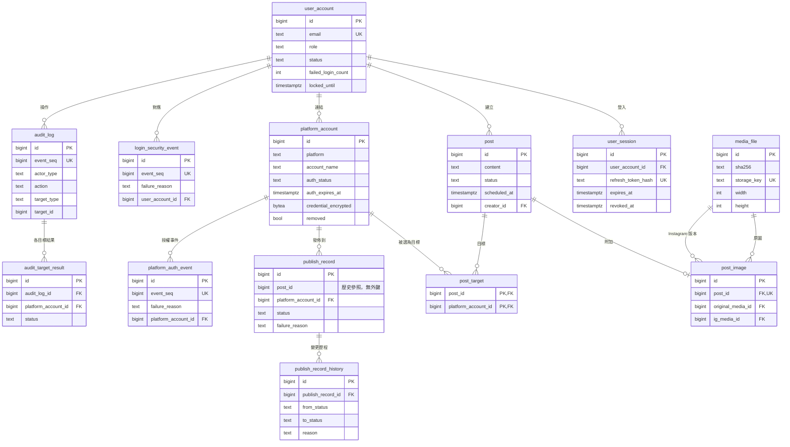

# mediagent 資料模型

> 對象：mediagent 全體組員
> 依據：`docs/requirements.md` 與 `spec/erm.dbml`
> 繳交時放在 `docs/data-model.md`
> 相關文件：《mediagent API 設計》、《mediagent 系統架構設計》、《mediagent 團隊協作規範》

本文件是**資料庫的唯一設計依據**。`spec/erm.dbml` 描述業務上需要的資料；本文件在其上加入實作需要的技術欄位與技術表，並規定每張表由哪個模組寫入。資料表名稱與 `spec/erm.dbml` 相同，方便對照規格與 pytest-bdd 測試。

---

## 1. 全域慣例

| 項目 | 規定 |
|---|---|
| 主鍵 | `BIGINT GENERATED ALWAYS AS IDENTITY`；列表「相同時依 ID 由大到小」的排序依賴遞增主鍵 |
| 日期時間 | `TIMESTAMPTZ`，一律存 UTC（NFR-09） |
| 文字 | `TEXT`；長度限制寫在 `CHECK` 或程式驗證 |
| 列舉值 | 存**英文代碼**（§2），以 `CHECK` 限制可用值；中文顯示文字由前端對照 |
| 時間戳記 | 可修改的表都有 `created_at`、`updated_at`；只能新增的表只有建立時間欄位 |
| 只能新增的表 | `audit_log`、`audit_target_result`、`login_security_event`、`platform_auth_event`、`publish_record_history`：以資料列層級 `BEFORE UPDATE OR DELETE` 與敘述層級 `BEFORE TRUNCATE` 資料庫觸發器禁止修改、刪除與清空（NFR-08） |
| 全域事件序號 | PostgreSQL 序列 `global_event_seq`，`audit_log`、`login_security_event`、`platform_auth_event` 的 `event_seq` 預設值皆為 `nextval('global_event_seq')` |
| 外鍵 | 一般關聯加外鍵；**歷史參照不加外鍵**（例如 `publish_record.post_id`，因貼文刪除後仍要保留原 ID，BR-35） |
| Migration | 第一版 migration 一次建立本文件所有表；之後的變更各自開 migration |

---

## 2. 列舉值代碼對照表

前端顯示一律使用中文；資料庫、API、程式碼一律使用代碼。

### 2.1 帳號

| 欄位 | 代碼 | 中文 |
|---|---|---|
| `user_account.role` | `admin` | 管理員 |
| | `publisher` | 發佈者 |
| | `writer` | 撰稿者 |
| `user_account.status` | `active` | 啟用 |
| | `disabled` | 停用 |
| `actor_type` | `user` | 使用者 |
| | `system` | 系統 |

### 2.2 平台帳號

| 欄位 | 代碼 | 中文 |
|---|---|---|
| `platform` | `threads` | Threads |
| | `instagram` | Instagram |
| | `discord` | Discord |
| `platform_account.auth_status` | `valid` | 有效 |
| | `invalid` | 失效 |

### 2.3 貼文與發佈

| 欄位 | 代碼 | 中文 |
|---|---|---|
| `post.status` | `DRAFT` | 草稿 |
| | `SCHEDULED` | 已排程 |
| | `PUBLISHING` | 發佈中 |
| | `PUBLISHED` | 發佈完成 |
| | `PARTIALLY_FAILED` | 部分失敗 |
| | `FAILED` | 全部失敗 |
| `publish_record.status` | `PENDING` | 待發佈 |
| | `SUCCEEDED` | 成功 |
| | `FAILED` | 失敗 |
| | `CANCELLED` | 已取消 |
| `publish_record.failure_reason` | `AUTH_EXPIRED` | 帳號授權過期 |
| | `AUTH_INVALID` | 帳號授權失效 |
| | `PLATFORM_UNAVAILABLE` | 平台暫時無法連線 |
| | `CONTENT_REJECTED` | 內容不符合平台限制 |
| | `TIMEOUT` | 發佈逾時 |
| | `OTHER` | 其他 |
| `publish_record.image_variant` | `original` | 原圖 |
| | `instagram` | Instagram 版本 |

### 2.4 發佈紀錄變更原因（`publish_record_history.reason`，NFR-12）

| 代碼 | 中文 | 寫入模組 |
|---|---|---|
| `SCHEDULE_SET` | 設定排程 | M4 |
| `PUBLISH_NOW` | 立即發佈 | M5 |
| `TARGET_ADDED` | 新增目標平台帳號 | M4 |
| `TARGET_MODIFIED` | 修改目標平台帳號 | M4 |
| `TARGET_ACCOUNT_REMOVED` | 目標平台帳號已移除 | M4（由 M2 觸發） |
| `SCHEDULE_CANCELLED` | 取消排程 | M4 |
| `RESCHEDULED` | 重新排程 | M4 |
| `POST_DELETED` | 刪除貼文 | M4（由 M3 觸發） |
| `PUBLISH_SUCCEEDED` | 發佈貼文：成功 | M5 |
| `PUBLISH_FAILED` | 發佈貼文：失敗 | M5 |
| `RETRY_STARTED` | 重試發佈：開始 | M5 |
| `RETRY_SUCCEEDED` | 重試發佈：成功 | M5 |
| `RETRY_FAILED` | 重試發佈：失敗 | M5 |
| `RECOVERY_CONFIRMED_PUBLISHED` | 發佈逾時恢復：已確認發佈 | M5 |
| `RECOVERY_CONFIRMED_NOT_PUBLISHED` | 發佈逾時恢復：確認未發佈 | M5 |
| `RECOVERY_UNCONFIRMED` | 發佈逾時恢復：無法確認 | M5 |
| `AUTO_RETRY_STARTED` | 自動重試發佈：開始 | M5 |
| `AUTO_RETRY_SUCCEEDED` | 自動重試發佈：成功 | M5 |
| `AUTO_RETRY_FAILED` | 自動重試發佈：失敗 | M5 |

### 2.5 稽核

| 欄位 | 代碼 | 中文 |
|---|---|---|
| `audit_log.action` | `LOGIN` | 登入 |
| | `LOGOUT` | 登出 |
| | `LOGOUT_ALL` | 登出所有裝置 |
| | `USER_CREATE` | 建立幹部帳號 |
| | `USER_ROLE_CHANGE` | 調整角色 |
| | `USER_DISABLE` | 停用帳號 |
| | `USER_ENABLE` | 啟用帳號 |
| | `USER_UNLOCK` | 解除鎖定 |
| | `PLATFORM_LINK` | 連結平台帳號 |
| | `PLATFORM_RELINK` | 重新連結平台帳號 |
| | `PLATFORM_REMOVE` | 移除平台帳號 |
| | `POST_PUBLISH` | 發佈貼文 |
| | `POST_SCHEDULE` | 設定排程 |
| | `SCHEDULE_CANCEL` | 取消排程 |
| | `PUBLISH_RETRY` | 重試發佈 |
| | `PUBLISH_AUTO_RETRY` | 自動重試發佈 |
| | `POST_COPY` | 複製為新草稿 |
| `audit_log.target_type` | `user_account` | 使用者帳號 |
| | `platform_account` | 平台帳號 |
| | `post` | 貼文 |
| `audit_log.result` | `PUBLISHED`、`PARTIALLY_FAILED`、`FAILED` | 同貼文狀態 |
| `audit_target_result.status` | `SUCCEEDED` | 成功 |
| | `FAILED` | 失敗 |
| | `NOT_RETRIED` | 未重試 |
| `audit_target_result.skip_reason` | `ALREADY_SUCCEEDED` | 先前已成功 |
| | `AUTH_INVALID_SKIPPED` | 授權失效而跳過 |
| | `REMOVED_SKIPPED` | 已移除而跳過 |
| `login_security_event.event_type` | `LOGIN_FAILED` | 登入失敗 |
| `login_security_event.failure_reason` | `WRONG_PASSWORD` | 密碼錯誤 |
| | `ACCOUNT_DISABLED` | 帳號停用 |
| | `ACCOUNT_LOCKED` | 帳號鎖定 |
| | `ACCOUNT_NOT_FOUND` | 帳號不存在 |
| `platform_auth_event.event_type` | `LINK_FAILED` | 連結平台帳號失敗 |
| | `RELINK_FAILED` | 重新連結平台帳號失敗 |
| `platform_auth_event.failure_reason` | `PLATFORM_AUTH_FAILED` | 平台授權失敗 |
| | `WEBHOOK_INVALID` | Webhook 驗證無效 |
| | `VERIFICATION_UNAVAILABLE` | 暫時無法驗證 |
| | `PLATFORM_ID_MISMATCH` | 平台帳號識別碼不一致 |

> 註：`audit_log.action` 另有待拍板項目 `PUBLISH_RECOVERY`（發佈逾時恢復，見《API 設計》§5 #2 與《需求規格》§10 #5；若確認採納則一併納入 `CHECK` 限制與 `labels.ts`）。

---

## 3. ERD

ERD 只列重點欄位，完整欄位見 §5。

---

## 4. 寫入權限（每張表由誰寫入）

**規則：任何模組都可以讀取任何表；只能寫入下表分配給自己的表或欄位。** 需要寫入別人的表時，呼叫該表擁有者提供的函式（§4.2）。

### 4.1 寫入權限矩陣

| 表 | 擁有者 | 其他可寫入者與範圍 |
|---|---|---|
| `user_account` | M1 | — |
| `user_session` | M1 | 共用核心：驗證 Token 時更新 `last_used_at` |
| `login_security_event` | M1 | — |
| `platform_account` | M2 | 共用核心 `mark_auth_invalid()`：發佈時平台明確回應授權失效，只改 `auth_status`（供 M5 使用） |
| `platform_auth_event` | M2 | — |
| `media_file` | M3 | — |
| `post` | M3：`content`、`creator_id`、`created_at`、刪除整筆 | M4：`status`（DRAFT↔SCHEDULED）、`scheduled_at`、`scheduled_by`；M5：`status`（→PUBLISHING、→結果）、`publishing_started_at`、`scheduled_at`（立即發佈已排程貼文時清空）。狀態轉換一律經共用核心 `transition_post()` 檢查 BR-12 |
| `post_image` | M3 | — |
| `post_target` | M4 | — |
| `publish_record` | M4：設定排程與修改目標時建立、`PENDING`↔`CANCELLED` | M5：立即發佈草稿時建立、`PENDING`→`SUCCEEDED`／`FAILED`、`FAILED`→`PENDING`（重試）、逾時恢復、發佈內容與圖片識別欄位。建立與狀態變更一律經共用核心 `publish_records` 函式，同時寫入變更歷程 |
| `publish_record_history` | 共用核心 `publish_records` 函式 | 不可直接寫入 |
| `audit_log` | 共用核心 `audit.write()` | 各模組呼叫，不可直接寫入 |
| `audit_target_result` | M5（經 `audit.write()` 一併寫入） | — |

### 4.2 跨模組寫入時呼叫的函式

| 函式 | 提供者 | 呼叫者 | 用途 |
|---|---|---|---|
| `lifecycle.on_platform_account_removed(account_id, actor)` | M4 | M2 | BR-23：從草稿與已排程貼文拿掉該帳號、待發佈紀錄改已取消、唯一目標時改回草稿 |
| `lifecycle.on_post_deleting(post_id, actor)` | M4 | M3 | 刪除已排程貼文前，將待發佈紀錄改為已取消（原因 `POST_DELETED`） |
| `core.platforms.mark_auth_invalid(account_id)` | 共用核心 | M5 | BR-09 |
| `core.posts.transition_post(post, to_status)` | 共用核心 | M4、M5 | BR-12 合法轉換檢查 |
| `core.publish_records.*` | 共用核心 | M4、M5 | 建立、改狀態、寫變更歷程 |
| `core.audit.write(...)` | 共用核心 | 全部 | 寫稽核紀錄與各目標結果 |

模組依賴只有 **M2 → M4、M3 → M4** 兩條，沒有循環；M4 與 M5 互不依賴。

---

## 5. 資料表

欄位標示：**[技術]** 為 `spec/erm.dbml` 沒有、實作需要的欄位。

### 5.1 `user_account`（使用者帳號，M1）

| 欄位 | 型別 | 空值 | 預設／限制 | 說明 |
|---|---|---|---|---|
| `id` | BIGINT | 否 | IDENTITY | 主鍵 |
| `email` | TEXT | 否 | UNIQUE；`CHECK (email = lower(btrim(email)))` | 標準化後的 Email（BR-40） |
| `name` | TEXT | 否 | | 顯示名稱 |
| `password_hash` | TEXT | 否 | | Argon2 雜湊；初始密碼至少 8 字元由程式驗證 |
| `role` | TEXT | 否 | `CHECK (role IN ('admin','publisher','writer'))` | |
| `status` | TEXT | 否 | `DEFAULT 'active'`；`CHECK (status IN ('active','disabled'))` | |
| `failed_login_count` | INT | 否 | `DEFAULT 0`；`CHECK (>= 0)` | 登入成功或解除鎖定時歸零 |
| `locked_until` | TIMESTAMPTZ | 是 | | 鎖定到期時間；到達即解除（BR-41） |
| `created_at`、`updated_at` | TIMESTAMPTZ | 否 | `DEFAULT now()` | **[技術]** |

- 至少一位 `role='admin' AND status='active'`（BR-19）由程式在同一交易中檢查，並鎖定管理員資料列避免兩位管理員同時互相降級。

### 5.2 `user_session`（登入工作階段，M1）**[技術表]**

BR-43 要求伺服器端能讓單一或全部登入憑證立即失效。

| 欄位 | 型別 | 空值 | 預設／限制 | 說明 |
|---|---|---|---|---|
| `id` | BIGINT | 否 | IDENTITY | 主鍵，寫入 JWT 的 `sid` |
| `user_account_id` | BIGINT | 否 | FK → `user_account` | |
| `refresh_token_hash` | TEXT | 否 | UNIQUE | Refresh Token 的 SHA-256；不存原文 |
| `created_at` | TIMESTAMPTZ | 否 | `DEFAULT now()` | |
| `last_used_at` | TIMESTAMPTZ | 否 | `DEFAULT now()` | |
| `expires_at` | TIMESTAMPTZ | 否 | | 建立後 7 天 |
| `revoked_at` | TIMESTAMPTZ | 是 | | 登出、登出所有裝置、帳號停用時填入 |

- 索引：`(user_account_id) WHERE revoked_at IS NULL`。
- 登出：撤銷 JWT 中 `sid` 對應的一筆；登出所有裝置：撤銷該使用者全部；停用帳號：撤銷全部。

### 5.3 `login_security_event`（登入安全事件，M1，只能新增）

| 欄位 | 型別 | 空值 | 預設／限制 | 說明 |
|---|---|---|---|---|
| `id` | BIGINT | 否 | IDENTITY | |
| `event_seq` | BIGINT | 否 | UNIQUE；`DEFAULT nextval('global_event_seq')` | |
| `event_type` | TEXT | 否 | `CHECK (event_type = 'LOGIN_FAILED')` | |
| `failure_reason` | TEXT | 否 | 見 §2.5 | 僅供內部追查 |
| `attempted_email` | TEXT | 否 | | 標準化後的 Email；不得保存密碼 |
| `user_account_id` | BIGINT | 是 | FK → `user_account` | `CHECK ((failure_reason = 'ACCOUNT_NOT_FOUND') = (user_account_id IS NULL))` |
| `occurred_at` | TIMESTAMPTZ | 否 | `DEFAULT now()` | |

### 5.4 `platform_account`（平台帳號，M2）

| 欄位 | 型別 | 空值 | 預設／限制 | 說明 |
|---|---|---|---|---|
| `id` | BIGINT | 否 | IDENTITY | |
| `platform` | TEXT | 否 | `CHECK (platform IN ('threads','instagram','discord'))` | |
| `platform_user_id` | TEXT | 是 | | Threads、Instagram 的平台識別碼；Discord 為空 |
| `account_name` | TEXT | 否 | | 帳號名稱或 Discord 頻道名稱 |
| `auth_status` | TEXT | 否 | `DEFAULT 'valid'`；`CHECK IN ('valid','invalid')` | 只記錄「平台明確回應失效」；時間到期另外計算（§5.4 說明） |
| `auth_expires_at` | TIMESTAMPTZ | 是 | `CHECK (platform <> 'discord' OR auth_expires_at IS NULL)` | |
| `credential_encrypted` | BYTEA | 否 | | MultiFernet 加密的 Token 或 Webhook 網址 |
| `credential_key_version` | INT | 否 | | **[技術]** 加密金鑰版本，供金鑰輪替 |
| `linked_by` | BIGINT | 否 | FK → `user_account` | 重新連結時不變 |
| `removed` | BOOLEAN | 否 | `DEFAULT false` | |
| `removed_at` | TIMESTAMPTZ | 是 | | **[技術]** |
| `created_at`、`updated_at` | TIMESTAMPTZ | 否 | `DEFAULT now()` | **[技術]** |

- 部分唯一索引：`UNIQUE (platform, account_name) WHERE NOT removed`。
- **有效授權狀態以讀取時計算**：`auth_status = 'invalid' OR (auth_expires_at IS NOT NULL AND auth_expires_at <= now())` 即為失效（BR-09）。不需要排程去更新欄位，由共用核心 `effective_auth_status(account, now)` 統一計算；API 回傳的授權狀態一律是計算後的值。
- 重新連結成功：更新 `account_name`、`credential_*`、`auth_expires_at`，`auth_status` 改回 `valid`（BR-38）。

### 5.5 `platform_auth_event`（平台授權事件，M2，只能新增）

| 欄位 | 型別 | 空值 | 預設／限制 | 說明 |
|---|---|---|---|---|
| `id` | BIGINT | 否 | IDENTITY | |
| `event_seq` | BIGINT | 否 | UNIQUE；`DEFAULT nextval('global_event_seq')` | |
| `event_type` | TEXT | 否 | `CHECK IN ('LINK_FAILED','RELINK_FAILED')` | |
| `platform` | TEXT | 否 | 同 `platform_account.platform` | |
| `account_name` | TEXT | 是 | | 已取得才記錄 |
| `failure_reason` | TEXT | 否 | 見 §2.5 | |
| `platform_account_id` | BIGINT | 是 | FK → `platform_account`；`CHECK (event_type <> 'RELINK_FAILED' OR platform_account_id IS NOT NULL)` | |
| `actor_id` | BIGINT | 否 | FK → `user_account` | |
| `occurred_at` | TIMESTAMPTZ | 否 | `DEFAULT now()` | |

不得保存任何憑證、Token 或 Webhook 網址。

### 5.6 `media_file`（圖片檔案，M3）**[技術表]**

規格要求「圖片檔案不再被引用時才刪除實體檔案」，而複製為新草稿會共用同一張圖，因此檔案與貼文圖片分開存放。

| 欄位 | 型別 | 空值 | 預設／限制 | 說明 |
|---|---|---|---|---|
| `id` | BIGINT | 否 | IDENTITY | |
| `storage_key` | TEXT | 否 | UNIQUE | MediaStorage 中的鍵 |
| `public_url` | TEXT | 否 | | 公開網址 |
| `sha256` | TEXT | 否 | | 檔案雜湊；發佈紀錄的 `image_sha256` 由此複製 |
| `format` | TEXT | 否 | `CHECK (format = 'jpeg')` | BR-04 |
| `size_bytes` | BIGINT | 否 | `CHECK (size_bytes BETWEEN 1 AND 8000000)` | BR-04 |
| `width`、`height` | INT | 否 | `CHECK (> 0)` | 像素 |
| `created_at` | TIMESTAMPTZ | 否 | `DEFAULT now()` | |

- 刪除規則：刪除或替換 `post_image` 後，若某個 `media_file` 已無任何 `post_image` 引用，於同一資料庫交易內刪除該 `media_file` 資料列，並於**交易成功提交後（post-commit）**才刪除 `MediaStorage` 中的實體檔案，確保交易回滾（rollback）時不會發生資料庫仍有引用但實體檔案已遺失的不一致。

### 5.7 `post`（貼文）

| 欄位 | 型別 | 空值 | 預設／限制 | 寫入者 | 說明 |
|---|---|---|---|---|---|
| `id` | BIGINT | 否 | IDENTITY | M3 | |
| `content` | TEXT | 否 | `CHECK (btrim(content) <> '')` | M3 | BR-01；字數上限依目標平台由程式檢查 |
| `status` | TEXT | 否 | `DEFAULT 'DRAFT'`；見 §2.3 | M4、M5 | 經 `transition_post()` |
| `scheduled_at` | TIMESTAMPTZ | 是 | `CHECK (status <> 'SCHEDULED' OR scheduled_at IS NOT NULL)`；`CHECK (status <> 'DRAFT' OR scheduled_at IS NULL)` | M4、M5 | 5 分鐘為單位由程式檢查（BR-10） |
| `scheduled_by` | BIGINT | 是 | FK → `user_account` | M4 | 最後一次成功設定排程者 |
| `creator_id` | BIGINT | 否 | FK → `user_account` | M3 | |
| `publishing_started_at` | TIMESTAMPTZ | 是 | | M5 | 進入發佈中的時間（BR-33） |
| `created_at` | TIMESTAMPTZ | 否 | `DEFAULT now()` | M3 | |
| `updated_at` | TIMESTAMPTZ | 否 | `DEFAULT now()` | 全部 | **[技術]** |

- 索引：`(created_at DESC, id DESC)`（列表）、`(status, scheduled_at)`（排程）、`(status, publishing_started_at)`（逾時恢復）。

### 5.8 `post_image`（貼文圖片，M3）

| 欄位 | 型別 | 空值 | 預設／限制 | 說明 |
|---|---|---|---|---|
| `id` | BIGINT | 否 | IDENTITY | |
| `post_id` | BIGINT | 否 | UNIQUE；FK → `post` ON DELETE CASCADE | 每則貼文最多一張（BR-03） |
| `original_media_id` | BIGINT | 否 | FK → `media_file` | 原圖 |
| `ig_media_id` | BIGINT | 否 | FK → `media_file` | Instagram 版本；比例已符合時等於原圖 |
| `created_at` | TIMESTAMPTZ | 否 | `DEFAULT now()` | |

`spec/erm.dbml` 的 `format`、`size_bytes`、`width`、`height`、`public_url`、`ig_public_url`、`ig_width`、`ig_height` 由對應的 `media_file` 取得，API 回傳時展開成相同欄位。

- 索引：`(original_media_id)`、`(ig_media_id)`（外鍵索引，加速檢查 `media_file` 是否仍被引用）。

### 5.9 `post_target`（目標平台帳號，M4）

| 欄位 | 型別 | 空值 | 預設／限制 | 說明 |
|---|---|---|---|---|
| `post_id` | BIGINT | 否 | PK；FK → `post` ON DELETE CASCADE | |
| `platform_account_id` | BIGINT | 否 | PK；FK → `platform_account` | |
| `created_at` | TIMESTAMPTZ | 否 | `DEFAULT now()` | **[技術]** |

- 索引：`(platform_account_id)`（複合主鍵已涵蓋 `post_id`；補此索引供移除平台帳號時反查受影響貼文）。

### 5.10 `publish_record`（發佈紀錄）

| 欄位 | 型別 | 空值 | 預設／限制 | 說明 |
|---|---|---|---|---|
| `id` | BIGINT | 否 | IDENTITY | |
| `post_id` | BIGINT | 否 | **無外鍵** | 貼文刪除後保留原 ID（BR-35） |
| `platform_account_id` | BIGINT | 否 | FK → `platform_account` | |
| `status` | TEXT | 否 | `DEFAULT 'PENDING'`；見 §2.3 | |
| `published_at` | TIMESTAMPTZ | 是 | `CHECK (status <> 'SUCCEEDED' OR published_at IS NOT NULL)` | |
| `platform_post_url` | TEXT | 是 | | 成功時記錄；Discord 的網址組成方式於 W08 驗證 |
| `platform_post_id` | TEXT | 是 | | **[技術]** 平台上的貼文 ID |
| `platform_request_ref` | TEXT | 是 | | **[技術]** 平台中途識別碼（例如 Instagram、Threads 的 container ID），供逾時恢復向平台確認 |
| `attempt_started_at` | TIMESTAMPTZ | 是 | | **[技術]** 最近一次開始呼叫平台的時間 |
| `content_summary` | TEXT | 是 | | 實際發佈的完整文字 |
| `image_sha256`、`image_format` | TEXT | 是 | | 實際送出的圖片識別資訊 |
| `image_width`、`image_height` | INT | 是 | | |
| `image_variant` | TEXT | 是 | `CHECK IN ('original','instagram')` | |
| `auto_retry_count` | INT | 否 | `DEFAULT 0`；`CHECK (auto_retry_count BETWEEN 0 AND 1)` | |
| `failure_reason` | TEXT | 是 | `CHECK (status <> 'FAILED' OR failure_reason IS NOT NULL)` | 見 §2.3 |
| `platform_error_message` | TEXT | 是 | | 只有管理員可看；寫入前過濾憑證 |
| `created_at`、`updated_at` | TIMESTAMPTZ | 否 | `DEFAULT now()` | **[技術]** |

- 唯一：`UNIQUE (post_id, platform_account_id)`（BR-16、BR-27 重用同一筆）。
- 索引：`(post_id, status)`、`(status, post_id)`、`(platform_account_id)`。

### 5.11 `publish_record_history`（發佈紀錄變更歷程，只能新增）

| 欄位 | 型別 | 空值 | 預設／限制 | 說明 |
|---|---|---|---|---|
| `id` | BIGINT | 否 | IDENTITY | |
| `publish_record_id` | BIGINT | 否 | FK → `publish_record` | |
| `from_status` | TEXT | 是 | NULL 表示初次建立 | |
| `to_status` | TEXT | 否 | `CHECK (from_status IS DISTINCT FROM to_status)` | |
| `changed_at` | TIMESTAMPTZ | 否 | `DEFAULT now()` | |
| `actor_type` | TEXT | 否 | `CHECK IN ('user','system')` | |
| `actor_id` | BIGINT | 是 | FK → `user_account`；`CHECK ((actor_type = 'system') = (actor_id IS NULL))` | |
| `reason` | TEXT | 否 | 見 §2.4 | |

- 索引：`(publish_record_id, changed_at ASC)`。

### 5.12 `audit_log`（稽核紀錄，只能新增）

| 欄位 | 型別 | 空值 | 預設／限制 | 說明 |
|---|---|---|---|---|
| `id` | BIGINT | 否 | IDENTITY | |
| `event_seq` | BIGINT | 否 | UNIQUE；`DEFAULT nextval('global_event_seq')` | |
| `actor_type` | TEXT | 否 | `CHECK IN ('user','system')` | |
| `actor_id` | BIGINT | 是 | FK → `user_account`；`CHECK ((actor_type = 'system') = (actor_id IS NULL))` | |
| `action` | TEXT | 否 | 見 §2.5 | |
| `target_type` | TEXT | 否 | `CHECK IN ('user_account','platform_account','post')` | |
| `target_id` | BIGINT | 否 | **無外鍵**（多型參照） | |
| `occurred_at` | TIMESTAMPTZ | 否 | `DEFAULT now()` | |
| `reason` | TEXT | 是 | | 自動重試發佈的觸發原因 |
| `related_post_id` | BIGINT | 是 | | 複製為新草稿時的新草稿 ID |
| `scheduled_by`、`post_creator_id` | BIGINT | 是 | FK → `user_account` | 系統自動發佈時記錄 |
| `result` | TEXT | 是 | `CHECK IN ('PUBLISHED','PARTIALLY_FAILED','FAILED')` | |

- 索引：`(occurred_at DESC, event_seq DESC)`、`(actor_id)`、`(target_type, target_id)`、`(action)`。

### 5.13 `audit_target_result`（稽核紀錄中各目標的執行結果，只能新增）

| 欄位 | 型別 | 空值 | 預設／限制 | 說明 |
|---|---|---|---|---|
| `id` | BIGINT | 否 | IDENTITY | |
| `audit_log_id` | BIGINT | 否 | FK → `audit_log` | |
| `platform_account_id` | BIGINT | 否 | FK → `platform_account` | |
| `status` | TEXT | 否 | `CHECK IN ('SUCCEEDED','FAILED','NOT_RETRIED')` | |
| `failure_reason` | TEXT | 是 | `CHECK (status <> 'FAILED' OR failure_reason IS NOT NULL)` | |
| `skip_reason` | TEXT | 是 | `CHECK ((status = 'NOT_RETRIED') = (skip_reason IS NOT NULL))` | |

- 索引：`(audit_log_id)`、`(platform_account_id)`。

---

## 6. 交易與併發控制（NFR-11）

| 情境 | 做法 |
|---|---|
| 所有會改變貼文狀態或發佈紀錄的操作 | 在交易開頭以 `SELECT ... FROM post WHERE id = ? FOR UPDATE` 鎖定貼文，再檢查狀態並修改 |
| 排程到期掃描 | `SELECT ... FROM post WHERE status = 'SCHEDULED' AND scheduled_at <= now() ORDER BY scheduled_at ASC, id ASC FOR UPDATE SKIP LOCKED`，避免與取消排程、修改目標、移除平台帳號同時處理同一則貼文 |
| 發佈逾時恢復掃描（BR-33） | `SELECT ... FROM post WHERE status = 'PUBLISHING' AND publishing_started_at <= now() - interval '10 minutes' ORDER BY publishing_started_at ASC, id ASC FOR UPDATE SKIP LOCKED`，避免多個恢復或背景工作重複接手同一則逾時貼文 |
| 移除平台帳號（BR-23） | 同一交易中先鎖定該 `platform_account`，再以 `SELECT ... FROM post WHERE id IN (...) ORDER BY id ASC FOR UPDATE` 依固定順序鎖定所有受影響貼文，逐則處理目標、發佈紀錄與狀態 |
| 背景發佈寫回結果 | 每筆發佈紀錄各自短交易；更新前確認該筆仍是 `PENDING`，避免逾時恢復與原任務重複寫入 |
| 最後一位管理員（BR-19） | 以 `SELECT ... FROM user_account WHERE role = 'admin' AND status = 'active' ORDER BY id ASC FOR UPDATE` 依固定順序鎖定所有啟用中管理員的列後再檢查數量 |
| 全域事件序號 | 由資料庫序列取號，保證唯一遞增 |
| 不可變紀錄保護（NFR-08） | `audit_log`、`audit_target_result`、`login_security_event`、`platform_auth_event`、`publish_record_history` 五張只能新增的表，同時掛載資料列層級 `BEFORE UPDATE OR DELETE` 與敘述層級 `BEFORE TRUNCATE` 觸發器阻擋修改、刪除與清空 |

- **確定性取鎖順序（防止 `40P01` 死鎖）**：同一交易需跨表取鎖時，一律遵循 **`platform_account → post → publish_record`** 順序；鎖定同表多筆資料列時，一律加上明確遞增排序（如 `ORDER BY id ASC FOR UPDATE`），禁止無序批次鎖定。

---

## 7. 種子資料（`seeds/seed_dev.py`）

- 使用者：三種角色各一位，另有一位停用帳號、一位鎖定中帳號。
- 平台帳號：Threads、Instagram、Discord 各一（開發環境皆對應 MockAdapter），另有一個授權已過期、一個已移除。
- 貼文：六種狀態各至少一則，含有圖片與需要 Instagram 裁切的圖片。

---

## 8. 與 `spec/erm.dbml` 的差異

| 項目 | `erm.dbml` | 本文件 | 原因 |
|---|---|---|---|
| 列舉值 | 中文 | 英文代碼（§2） | 團隊決定；中文由前端顯示 |
| 主鍵型別 | `long` | `BIGINT IDENTITY` | 相同語意 |
| `post_image` 的圖片欄位 | 直接存在表內 | 拆到 `media_file`，`post_image` 參照 | 複製草稿共用圖片，需要判斷檔案是否仍被引用 |
| 新增技術表 | — | `user_session`、`media_file` | 伺服器端登出（BR-43）；圖片引用（4.3） |
| 新增技術欄位 | — | `created_at`／`updated_at`、`credential_key_version`、`removed_at`、`platform_post_id`、`platform_request_ref`、`attempt_started_at` | 金鑰輪替、逾時恢復向平台確認 |
| `publish_record.post_id` 的外鍵 | 註解保留邏輯參照（無實體 Ref） | 不加外鍵約束 | 貼文刪除後保留原 ID |
| 授權到期 | 欄位值 | 讀取時計算有效狀態 | 不需要排程更新欄位 |
